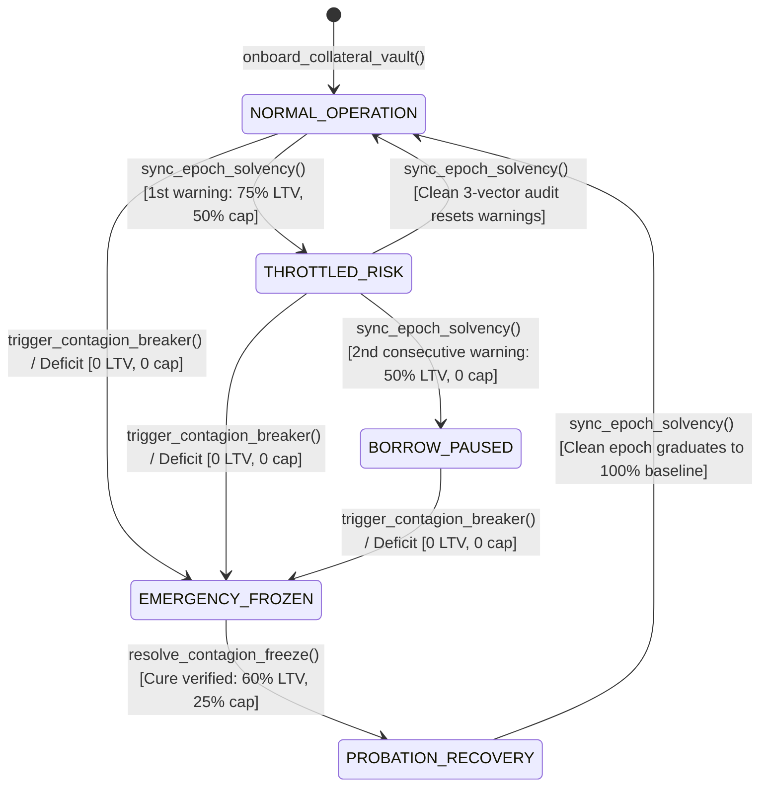

# RWACollateralSolvencySentinel

> **A Stateful RWA Solvency Oracle & Dynamic DeFi Lending Risk Engine on GenLayer**  
> **Target Submission:** GenLayer Builder Program - "Intelligent Contracts" Track (0-300 Points Target)  
> **Target Network:** GenLayer Studio (`studionet`) / Bradbury Testnet  
> **Deployed Contract Address:** `0xBcC561671804813dEB790CA9b90C7d5D75b1a2aa`  
> **Status:** Production-Ready | 100% Pure ASCII | Multi-Epoch Hysteresis & Circuit-Breaker Engine

---

## 1. Builder Portal Submission Metadata

Ready-to-copy metadata for the GenLayer Builder Portal submission form:

- **Track:** Intelligent Contracts (0-300 Points Target)
- **Project Title:** RWACollateralSolvencySentinel: RWA Solvency Oracle & Dynamic DeFi Risk Engine
- **Project Description (< 1,000 characters):**
  ```text
  RWACollateralSolvencySentinel is an on-chain Real-World Asset (RWA) reserve solvency oracle and dynamic DeFi lending risk engine on GenLayer. Translating auditor attestations, custodian feeds, and contagion bulletins into dynamic LTV haircuts and circuit breakers requires non-deterministic reasoning beyond EVM logic.

  Architecture:
  - 3 storage models (AssetVaultProfile, AttestationEpoch, ContagionIncident) across 4 write methods with multi-epoch hysteresis (2 consecutive warning epochs escalate THROTTLED_RISK to BORROW_PAUSED) and PROBATION_RECOVERY unfreezing.
  - 3 gl.vm.run_nondet_unsafe engines where validators enforce exact agreement on a 3-vector risk tuple (reserve_coverage_tier, liquidity_duration_tier, custodian_standing), deterministically binding current_ltv_bps, penalties, and borrow caps with zero divergence.

  Deployment (studionet): 0xBcC561671804813dEB790CA9b90C7d5D75b1a2aa
  Integration: Lending pools call compute_max_borrowable(vault_id, units).
  ```
  *(Length: 972 characters - strictly under the 1,000 character limit)*
- **Tags:** `intelligent-contracts`, `rwa`, `defi-risk`, `circuit-breaker`, `lending`, `solvency-oracle`, `hysteresis`, `genlayer`

---

## 2. Why This Primitive is 100% Architecturally Unique

DeFi money markets (such as Morpho Blue, Aave, and MakerDAO RWA vaults) hold billions in tokenized Treasury bills and custodial stablecoins (`USTB`, `OUSG`, `BUIDL`, `USDM`), yet EVM contracts are blind to off-chain reserve attestations, maturity drift, and custodian bank receivership until a catastrophic depeg has already drained lending pools.

**RWACollateralSolvencySentinel** introduces a quantitative, multi-epoch DeFi risk stewardship architecture:

1. **Three-Table Relational Storage Schema:**
   - `AssetVaultProfile`: Tracks baseline vs. active LTV (`bps`), liquidation penalties (`bps`), borrow caps, `consecutive_warnings`, and `epoch_cursor`.
   - `AttestationEpoch`: Immutable rolling ledger (`{vault_id}#E{epoch}`) of multi-dimensional solvency audits.
   - `ContagionIncident`: Tracks emergency black-swan contagion alerts and post-incident recapitalization proofs.
2. **Three Independent `gl.vm.run_nondet_unsafe` Consensus Workflows:**
   - `sync_epoch_solvency`: Evaluates auditor reserve reports + custodian telemetry across a **3-vector orthogonal risk tuple** (`reserve_coverage_tier`, `liquidity_duration_tier`, `custodian_standing`).
   - `trigger_contagion_breaker`: Flash black-swan monitor filtering `UNSUBSTANTIATED_NOISE` from genuine `CUSTODIAN_INSOLVENCY` / `REDEMPTION_GATED` / `REGULATORY_SEIZURE` events.
   - `resolve_contagion_freeze`: Audits recapitalization / custodian migration proofs to unfreeze vaults safely.
3. **Multi-Epoch Hysteresis & Gradual Probation Graduation:**
   - **1st Warning Epoch:** Transitions vault to `THROTTLED_RISK` (25% LTV haircut, 50% borrow cap throttle, +250 bps liquidation penalty).
   - **2+ Consecutive Warning Epochs:** Hysteresis automatically escalates to `BORROW_PAUSED` (50% LTV haircut, `active_borrow_cap = 0`, `new_borrows_allowed = False`).
   - **Post-Contagion Probation:** Cured `EMERGENCY_FROZEN` vaults enter `PROBATION_RECOVERY` (60% of baseline LTV, 25% of max cap) and only graduate back to 100% `NORMAL_OPERATION` after passing a subsequent clean epoch sync.
4. **Economically Equivalent Risk Curve Binding:** Validators require exact agreement on all discrete risk vectors, and `derive_epoch_risk_curve(...)` deterministically computes exact basis-point LTVs, penalties, and borrow caps on-chain with zero node-to-node divergence.

---

## 3. Multi-Epoch Risk & Circuit-Breaker State Machine



---

## 4. Deployment (studionet) & Worked Example

- **Network:** `studionet`
- **Contract Address:** `0xBcC561671804813dEB790CA9b90C7d5D75b1a2aa`
- **Explorer URL:** https://explorer-studio.genlayer.com/address/0xBcC561671804813dEB790CA9b90C7d5D75b1a2aa
- **Contract Source:** `contracts/rwa_collateral_sentinel.py`

### Worked Example: Multi-Epoch RWA Vault Onboarding & Solvency Sync

#### Step 1: Onboard RWA Collateral Vault (`onboard_collateral_vault`)
```python
contract.onboard_collateral_vault(
    vault_id="USTB-VAULT-01",
    asset_symbol="USTB",
    issuer_entity="Superstate Short Duration Trust",
    reserve_mandate="100% US Treasury Bills maturing within 90 days held at qualified custodian.",
    base_ltv_bps=8000,
    base_liq_penalty_bps=400,
    max_borrow_cap=10000000
)
# Returns "USTB-VAULT-01" in circuit_state "NORMAL_OPERATION"
```

#### Step 2: Run Epoch Solvency Sync (`sync_epoch_solvency`)
```python
snapshot_key = contract.sync_epoch_solvency(
    vault_id="USTB-VAULT-01",
    attestation_url="https://attest.superstate.co/2026-10",
    custodian_feed_url="https://custodian.umb.com/feeds/ustb"
)
# Expected illustrative consensus output when 1st minor reserve buffer dip (99.1%) occurs:
# snapshot_key == "USTB-VAULT-01#E0001"
# reserve_coverage_tier == "NARROW_BUFFER_98_TO_100"
# circuit_state == "THROTTLED_RISK"
# current_ltv_bps == 6000 (deterministic 25% haircut from 8000 bps)
# active_borrow_cap == 5000000 (deterministic 50% throttle from 10,000,000)
# compute_max_borrowable("USTB-VAULT-01", 1000000) == 600000
```

---

## 5. Downstream DeFi Money Market Integration

```python
from genlayer import *

class IsolatedRWALendingMarket(gl.Contract):
    sentinel_address: Address

    @gl.public.write
    def originate_loan(self, vault_id: str, collateral_units: int, requested_loan: int) -> None:
        sentinel = gl.get_contract_at(self.sentinel_address)
        max_safe_loan = sentinel.compute_max_borrowable(vault_id, collateral_units)
        if requested_loan > max_safe_loan:
            raise gl.vm.UserError("Loan exceeds dynamic RWA solvency risk limit")
        # Disburse loan...
```

---

## 6. Testing & Verification

```bash
gltest tests/test_rwa_collateral_sentinel.py -v -s
pytest tests/test_rwa_collateral_sentinel.py -v
```
